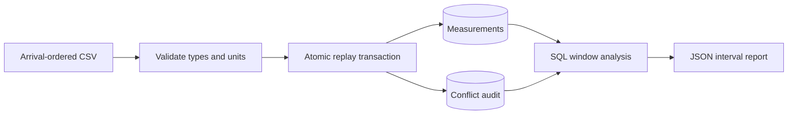

# Telemetry Replay

[](https://github.com/leedanie2/telemetry-replay/actions/workflows/ci.yml)

**Replay energy telemetry without double-counting retries or silently overwriting conflicting measurements.**

A Python/PostgreSQL CLI with transactional ingestion, conflict auditing, SQL window
analysis, optional device filtering, and a reproducible Docker demo.

**Verified dataset:** 111,000 synthetic deliveries → 100,000 distinct measurements,
10,000 exact duplicates, and 1,000 conflicting deliveries. Replaying the dataset
adds no measurement rows or duplicate audit entries. See [measured results](docs/RESULTS.md).

## Run in one command

Requires Git and a running Docker engine with Compose v2:

```sh
git clone https://github.com/leedanie2/telemetry-replay.git
cd telemetry-replay
docker compose run --build --rm app demo
```

The demo creates an isolated schema, verifies expected results, and rolls it back.
Existing application data is untouched. PostgreSQL starts automatically and is
health-checked before the app runs.

Expected summary (the actual output also includes the interval report):

```json
{
  "demo_passed": true,
  "first_replay": {"inserted": 6, "duplicates": 1, "conflicts": 0},
  "second_replay": {"inserted": 0, "duplicates": 7, "conflicts": 0},
  "conflicting_replay": {"inserted": 0, "duplicates": 2, "conflicts": 1},
  "valid_interval_subtotal_j": "51.0000000000000000",
  "full_period_total_j": null,
  "persistent_data_changed": false
}
```

The full-period total is unknown because measurements cannot establish energy
consumption across the reboot boundary. [Captured demo output](docs/evidence/demo.json).
Stop containers with `docker compose down`; the database volume remains intact.

## What it demonstrates

| Capability | Implementation |
|---|---|
| SQL / PostgreSQL | Composite keys, constraints, foreign keys, transactions, LAG/window queries, EXPLAIN ANALYZE |
| Reliable replay | One transaction per file; exact retries ignored; conflicting payloads audited |
| Measurement analysis | Device/boot partitions, event-time ordering, gaps and invalid-interval flags |
| Docker | Non-root Python image, PostgreSQL health check, persistent volume |
| CI | Image build, unit and real-database tests, isolated demo, persistent CLI smoke checks |



A reading is identified by **device + boot + sequence**. The first committed payload
is preserved on a conflict; it is not assumed to be the correct one. Windows never
cross devices or boots. A gap can produce an interval average; a counter reset
cannot be treated as continuous consumption.

## Persistent use

On a fresh Compose database:

```sh
docker compose run --rm app init-db
docker compose run --rm app register-device A 'Synthetic meter'
docker compose run --rm app replay fixtures/readings.csv
docker compose run --rm app replay fixtures/readings.csv
docker compose run --rm app report --device A
```

Run `init-db` once. It refuses to replace existing tables. Omit `--device` for all
devices; an unknown device returns `[]`.

## Review the project

- [Setup, commands, and tests](docs/SETUP.md)
- [Architecture and tradeoffs](docs/ARCHITECTURE.md)
- [Measurements and raw evidence](docs/RESULTS.md)
- [Docker and CI design](docs/CONTAINERS.md)
- Core code: [replay](telemetry/service.py), [schema](sql/001-schema.sql), [report query](sql/report.sql), [integration tests](tests/test_integration.py)

## Scope and provenance

All bundled data is synthetic. Implementation, tests, and documentation were
developed with substantial AI assistance; design choices and verification evidence
are documented explicitly.

This is a bounded local portfolio service, not a production deployment. Input is
loaded into memory; ingestion uses readable per-row SQL. Opposite-order concurrent
batches can deadlock and require replay. No cloud, high availability, or abrupt
power-loss guarantee is claimed. See the architecture document for assumptions.
