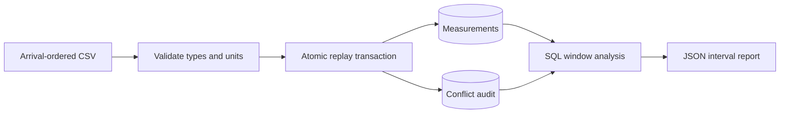

# Telemetry Replay

[](https://github.com/leedanie2/telemetry-replay/actions/workflows/ci.yml)

Replay energy telemetry without double-counting retries or silently overwriting
conflicting measurements. Python/PostgreSQL CLI with transactional ingestion,
conflict auditing, SQL window analysis, and a Docker demo.

**Verified dataset:** 111,000 synthetic deliveries → 100,000 distinct measurements,
10,000 exact duplicates, 1,000 conflicts. Replaying adds no measurement rows or
audit entries ([results](docs/RESULTS.md)).

## Run

Requires Git and Docker with Compose v2:

```sh
git clone https://github.com/leedanie2/telemetry-replay.git
cd telemetry-replay
docker compose run --build --rm app demo
```

The demo uses an isolated schema, checks the expected results, and rolls back.
Captured output: [docs/evidence/demo.json](docs/evidence/demo.json). The full-period
total is `null` by design: measurements can't establish consumption across a reboot.

Persistent use:

```sh
docker compose run --rm app init-db
docker compose run --rm app register-device A 'Synthetic meter'
docker compose run --rm app replay fixtures/readings.csv
docker compose run --rm app report --device A
```

## Design



A reading is identified by **device + boot + sequence**. One transaction per file;
exact retries are ignored; on a conflict the first committed payload is kept and
the conflict is audited. Windows never cross devices or boots. CI builds the image
and runs unit and real-database tests, the demo, and CLI smoke checks.

More: [setup](docs/SETUP.md) · [architecture](docs/ARCHITECTURE.md) ·
[containers and CI](docs/CONTAINERS.md) · [schema](sql/001-schema.sql) ·
[report query](sql/report.sql)

## Scope

All data is synthetic. This is a bounded local portfolio service, not a production
deployment: input is loaded into memory, and opposite-order concurrent batches can
deadlock and need replay. Developed with substantial AI assistance.
